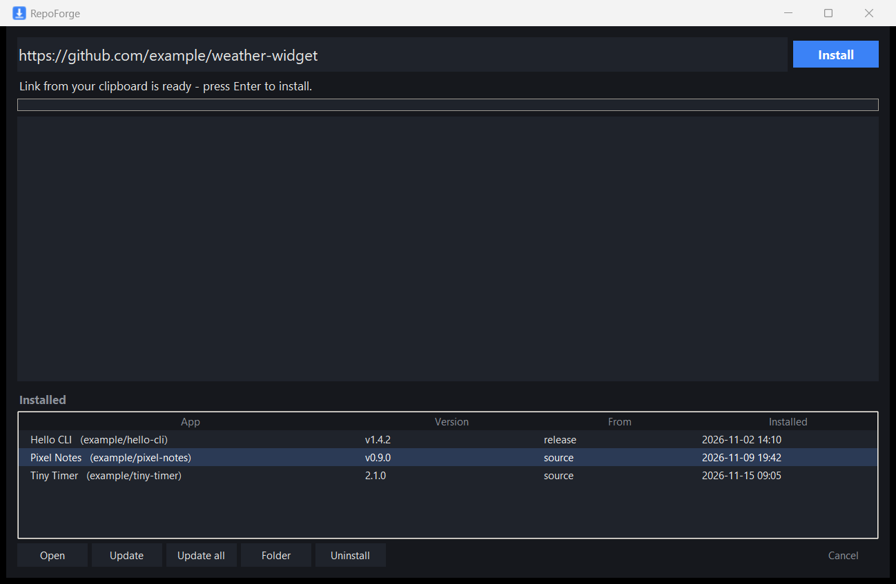

# RepoForge

Paste a GitHub link, and RepoForge builds that project from the creator's own source code and installs it on your
Windows PC. It makes Start menu and desktop shortcuts for apps, and commands you can type in a terminal for
command-line tools. It can also update and uninstall what it installed.

The build itself is done by the Claude Code CLI: an AI agent reads the project's build notes and CI files,
installs the tools it needs with winget, builds the program and tells RepoForge where it is.

## What it looks like



*Paste a GitHub link at the top and press Install. The list at the bottom shows what is installed; the buttons open,
update or uninstall the selected app. (Example data: the apps shown are made up.)*

## Read this first: safety

- **The AI agent runs with no limits.** RepoForge starts the Claude Code CLI with
  `--permission-mode bypassPermissions`. That means it can run any command on your PC without asking you first.
- **There is no sandbox.** It works on your real PC, with your user account, on code from the repo you picked.
  That code (build scripts, install scripts) runs too.
- **It installs software.** It installs compilers and other tools with winget (Windows may show admin prompts).
  If a project can't be built on Windows, it may download the creator's own release from GitHub and, as a last
  resort, run the creator's installer.
- **It uses your Claude plan.** Every build uses your Claude Code usage (the model is set in `config.json`).
- Only use it with repos you trust. You use it at your own risk.

## What it changes on your PC

- **Apps folder:** everything it installs goes in one folder, by default `%USERPROFILE%\RepoForgeApps`
  (one sub-folder per project). You can change it in `config.json`.
- **App list:** `repoforge-registry.json` in the apps folder keeps track of what is installed. If this file is ever
  damaged, RepoForge keeps it aside (as `repoforge-registry.json.broken-...`), starts with an empty list and tells you.
- **PATH:** for command-line tools it adds `<apps folder>\bin` to your user PATH (no admin needed).
- **Shortcuts:** in the Start menu (folder "RepoForge") and, unless you turn it off, on your desktop.
- **Tools:** whatever the build agent installs with winget (for example Git, Rust, Node.js, Visual Studio Build Tools).
- **Next to RepoForge:** `config.json` (your settings) and a `logs` folder with one log per build.

## What you need

- Windows 10 or 11
- [Python 3.12 or newer](https://www.python.org/downloads/) with tkinter (the normal python.org installer has it).
  Tick "Add python.exe to PATH" when you install it.
- [Git for Windows](https://git-scm.com/download/win) on your PATH
- [Claude Code](https://docs.anthropic.com/en/docs/claude-code) installed and logged in (needs a Claude plan)
- winget (the "App Installer" from the Microsoft Store; most Windows 10/11 PCs already have it)
- Optional: a `GITHUB_TOKEN` environment variable, if you hit GitHub's limit on requests without a login

RepoForge itself only uses Python's standard library: there is nothing to `pip install`.

## Setup

1. Download or clone this repo.
2. Optional: copy `config.example.json` to `config.json` and change it. If there is no `config.json`, RepoForge
   makes one with the defaults the first time it starts. If `config.json` has a mistake in it, RepoForge
   doesn't start: it tells you what is wrong and leaves the file as it is, so you can fix it.

Settings in `config.json`:

| Setting | Default | What it does |
|---|---|---|
| `apps_dir` | `%USERPROFILE%\RepoForgeApps` | Where apps are installed. `%NAME%` environment variables work. |
| `model` | `sonnet` | The Claude model the build agent uses. |
| `desktop_shortcuts` | `true` | Also put app shortcuts on the desktop. |
| `launch_after_install` | `true` | Start an app once it is installed. |
| `max_nudges` | `3` | How many times the agent is asked to keep going when it stops before it's done. |

## Run

- Double-click `Start-RepoForge.bat` (it starts the window with `pythonw`).
- Or from a terminal: `python repoforge.py` for the window, or `python repoforge.py https://github.com/owner/repo`
  to install one project without the window (it exits with code 1 when the install fails).

Paste a link like `https://github.com/owner/repo` (a release or branch link works too) and press Enter.
Use the buttons under "Installed" to update or uninstall apps.

Note: if the creator's own installer was used, RepoForge runs that program's uninstaller when the installer left
one. If the program is still on your PC afterwards, RepoForge tells you, and you remove it in Windows Settings > Apps.

## Test

From the repo folder:

```
python -m unittest
```

The tests use a temp folder for the settings, the app list and the apps, so they don't touch your real install.
They don't start a build or the Claude Code CLI. The privacy check uses Git to see which files a commit
would include, so your own `config.json` and `logs` are skipped.

## Build

There is nothing to build: RepoForge is one Python file (`repoforge.py`).

## Credits

- Uses [Python](https://www.python.org/) (tkinter), [Git](https://git-scm.com/),
  [Claude Code](https://docs.anthropic.com/en/docs/claude-code) by Anthropic and
  [winget](https://learn.microsoft.com/windows/package-manager/). None of them are included here; you install them.
- The icon (`repoforge.ico`) was made for this project.

Built with Claude Code.

## License

MIT - see [LICENSE](LICENSE).
